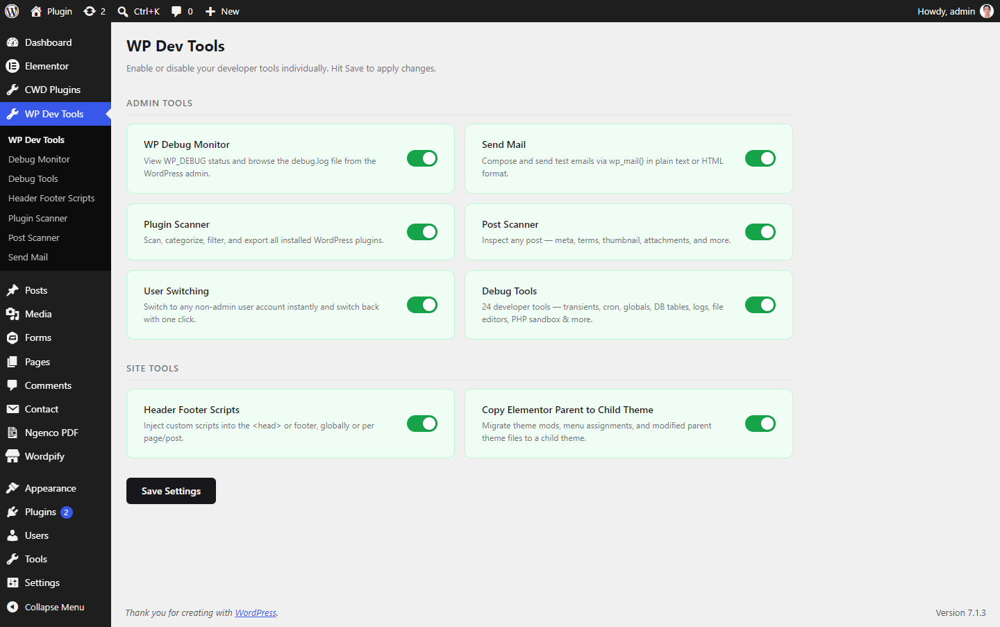
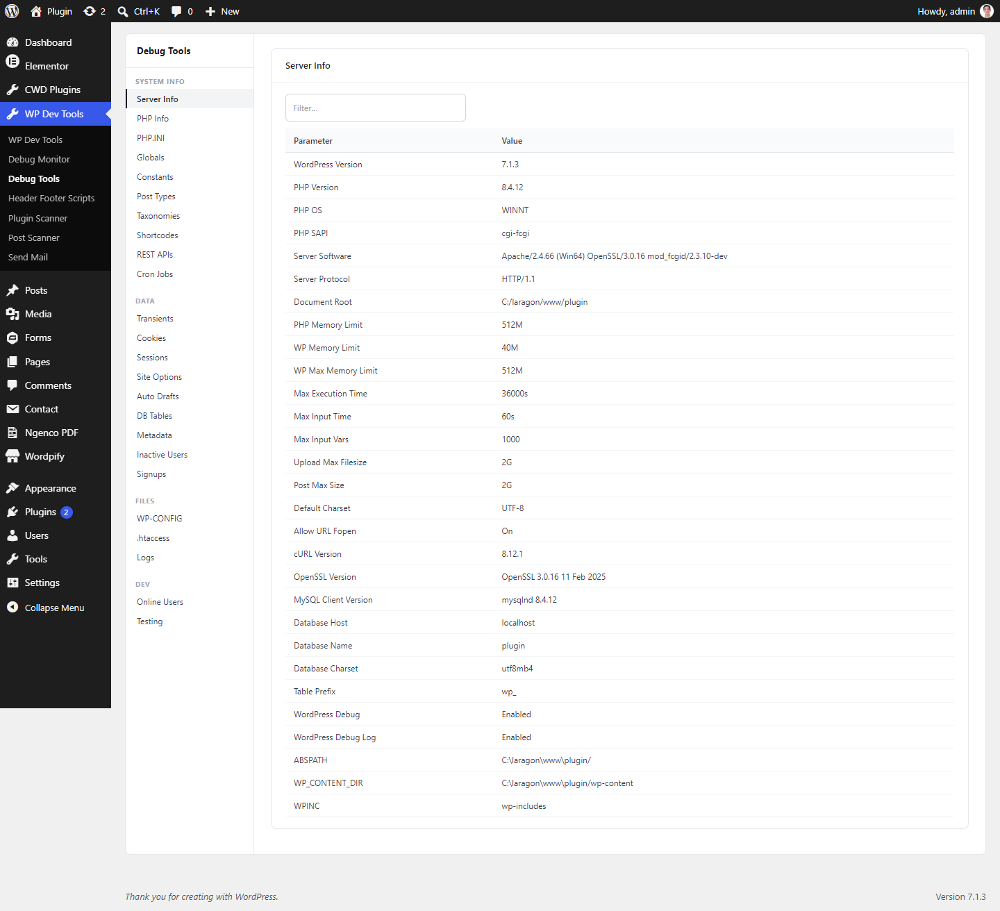
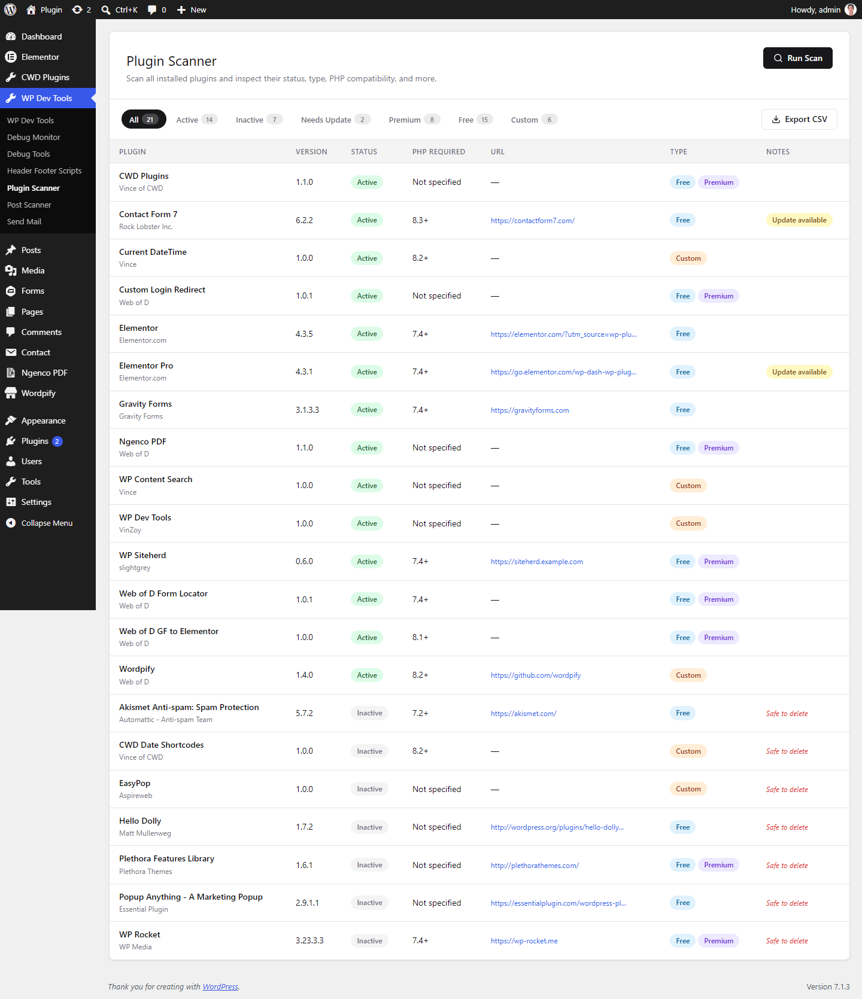
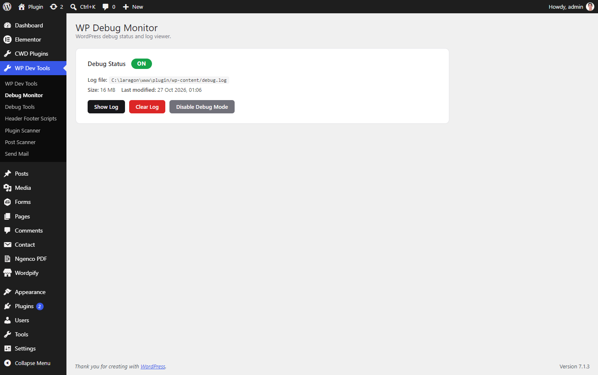
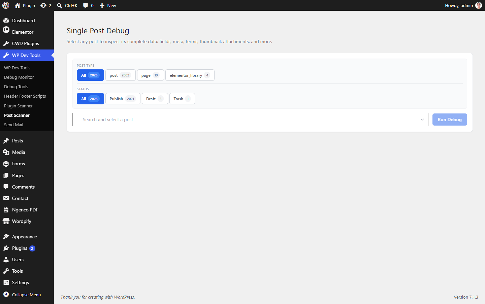
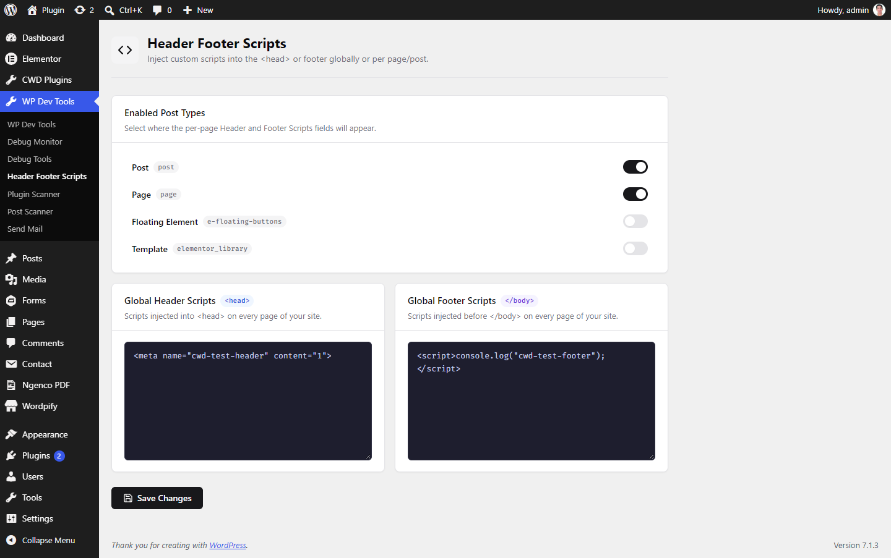
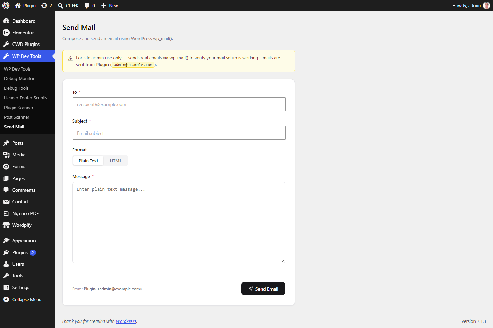

# WP Dev Tools

A modular WordPress developer toolkit. It puts a set of debugging, inspection and site-maintenance tools in one admin menu. Each tool is a self-contained module you switch on or off from a single dashboard, and modules you switch off never load.



## Features

### Admin Tools
Only administrators can switch these on or off.

| Module | What it does |
|---|---|
| **WP Debug Monitor** | Shows whether `WP_DEBUG` is on and the size of `debug.log`. You can view, clear or switch off debug logging from the admin. |
| **Send Mail** | Compose and send test emails through `wp_mail()` in plain text or HTML, to check that site mail works. |
| **Plugin Scanner** | Scans every installed plugin and lists its status, version, required PHP version and type (free, premium or custom). You can filter the list, see which plugins have updates or are safe to delete, and export it to CSV. |
| **Post Scanner** | Inspect any post's fields, meta, terms, thumbnail and attachments. |
| **User Switching** | Switch to any non-admin user and back with one click. The switch cookie is signed, and you can't switch to another administrator. |
| **Debug Tools** | 24 developer panels: server info, PHP info, `php.ini`, globals, constants, post types, taxonomies, shortcodes, REST APIs, cron jobs, transients, cookies, sessions, site options, auto drafts, DB tables, metadata, inactive users, signups, `wp-config.php`, `.htaccess`, logs, online users, and a testing sandbox. |

### Site Tools
Any user who can access the page can switch these on or off.

| Module | What it does |
|---|---|
| **Header Footer Scripts** | Add scripts to `<head>` or before `</body>`, either site-wide or per post or page, for the post types you choose. |
| **Copy Elementor Parent to Child Theme** | Copies theme mods, menu assignments and modified parent theme files to a Hello Elementor child theme. |

## Screenshots

| | |
|---|---|
| **Debug Tools**<br> | **Plugin Scanner**<br> |
| **Debug Monitor**<br> | **Post Scanner**<br> |
| **Header Footer Scripts**<br> | **Send Mail**<br> |

## Requirements

- WordPress 6.0+
- PHP 8.0+

No build step is needed. The plugin is plain PHP, with no Composer or npm.

## Installation

1. Clone or download this repo into `wp-content/plugins/`:
   ```bash
   cd wp-content/plugins
   git clone https://github.com/slightgrey/wp-dev-tools.git
   ```
2. Activate **WP Dev Tools** under **Plugins**.
3. Go to **WP Dev Tools** in the admin menu, switch on the modules you want, and click **Save Settings**.

> These tools expose server details, config files and other users' accounts. Use them on development and staging sites, or switch them off when you don't need them on production.

## Architecture

```
vl-admin-tools.php            Bootstrap: constants, activation hooks
includes/
  class-admin-tools.php       Main class: builds the container, boots enabled modules
  core/                       Loader, activator, deactivator, i18n
  di/                         DI container, module interface, module autoloader
admin/                        Dashboard page (module toggles)
modules/<slug>/
  register.php                Binds services and returns the module manifest
  class-at-<slug>.php         Module root class (implements boot())
  admin/ public/              Module-specific admin and front-end classes and assets
```

- **Auto-discovery.** The plugin finds every `modules/*/register.php` with a glob, so a new module needs no core edits.
- **Lazy boot.** Only the modules listed in the `admin_tools_enabled_modules` option have `boot()` called.
- **Hook loader.** Modules register hooks through `Admin_Tools_Loader`, never `add_action()` directly.
- **Autoloader.** `at_autoload_module( __DIR__ )` maps `AT_Foo_Bar` to `class-at-foo-bar.php` in the module's root, `admin/` or `public/` folder.

### Adding a module

```php
// modules/my-module/register.php
<?php defined( 'ABSPATH' ) || exit;

return function( $c ) {
    at_autoload_module( __DIR__ );

    $c->bind( AT_MyModule_Admin::class, fn() => new AT_MyModule_Admin() );
    $c->bind( AT_MyModule::class, fn( $c ) => new AT_MyModule( $c->get( AT_MyModule_Admin::class ) ) );

    return [ 'id' => 'my-module', 'class' => AT_MyModule::class ];
};
```

Then add a toggle card for it in `admin/partials/admin-tools-admin-display.php`, and add its slug to the allowed list in `Admin_Tools_Admin::handle_save()`.

## Uninstall

Deleting the plugin removes the `admin_tools_enabled_modules` option.

## License

GPL-3.0. See [LICENSE](LICENSE).
